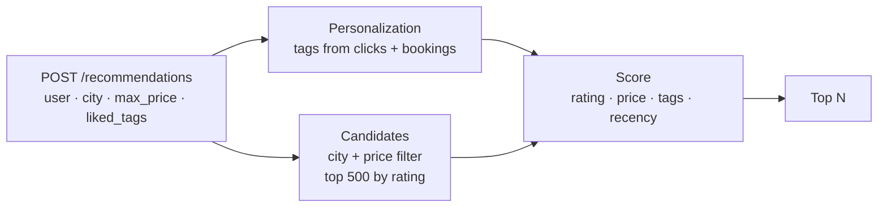

# Travel Recommendation Ranking Engine

**A FastAPI service that ranks travel stays for a traveler: Postgres filters the catalog by city and budget, then a weighted, normalized score blends rating, price, tag match, and listing freshness — with tags from the user's click and booking history folded into their stated preferences.**

Ranking has two halves. The database should do the cheap, selective work (city, price ceiling, a bounded candidate set), and the application should do the scoring, where features need to be comparable and weights need to mean something. This project keeps those halves separate behind a small repository layer.



## Scoring

Every feature is normalized to 0–1 so the weights compare like for like:

| Feature | Formula | Weight |
|---|---|---|
| Rating | `rating / 5` | 1.0 |
| Price | `1 − price / max_price` (cheaper is better) | 0.6 |
| Tag match | share of the traveler's liked tags the listing has | 0.8 |
| Recency | exponential decay with a 30-day half-life | 0.4 |

Liked tags are the union of what the request asks for and the tags of listings the user previously clicked or booked.

A diversity re-ranker (`app/diversity.py`) caps how many results of each listing kind (hotel, apartment, …) appear, preserving best-first order and backfilling from held-back results when the cap leaves the list short.

## Data model

`db/schema.sql` defines `listings` (with a composite `(city, price_per_night)` index for the main filter and a GIN index on `tags`) and `interactions` (indexed by user and recency for personalization lookups). Candidate queries order by `rating DESC, id ASC`, so ties break deterministically and pagination is stable.

## API

```http
POST /recommendations
{ "user_id": "u-42", "city": "Lisbon", "max_price": 200, "liked_tags": ["beach"], "limit": 10 }
```

Returns `{ "city", "count", "results": [ { id, kind, price_per_night, rating, tags, days_old, score }, … ] }`. `max_price` must be positive and `limit` is 1–50.

## Running

Requires Python 3.10+ and PostgreSQL.

```bash
git clone https://github.com/AliAzamat/travel-recommendation-ranking-engine.git
cd travel-recommendation-ranking-engine
pip install fastapi uvicorn "psycopg[binary]" psycopg_pool pytest

python -m pytest -q        # 4 scoring and diversity tests (no database needed)

createdb travel
psql -d travel -f db/schema.sql
export DATABASE_URL=postgresql:///travel
```

Configuration: `DATABASE_URL`, `DB_POOL_MIN` (default 1), `DB_POOL_MAX` (default 10).
